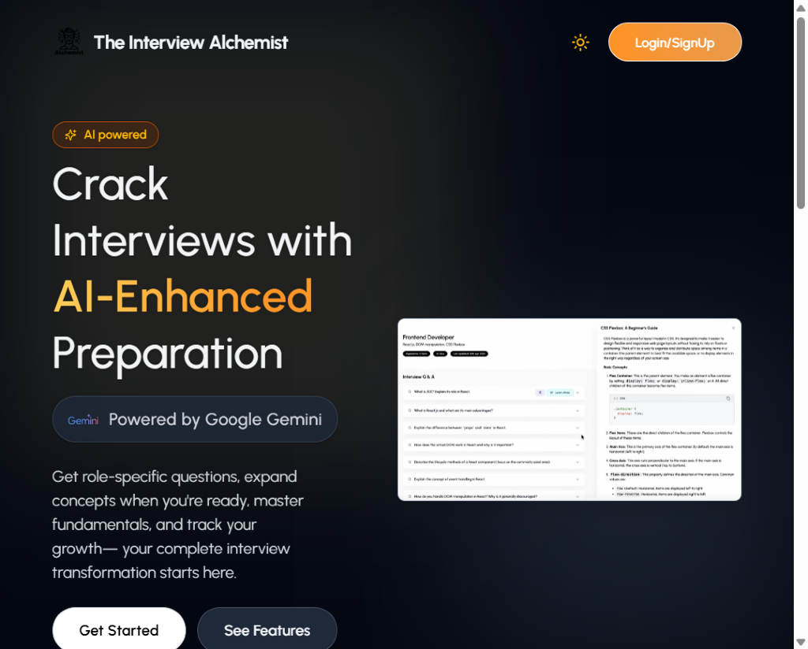
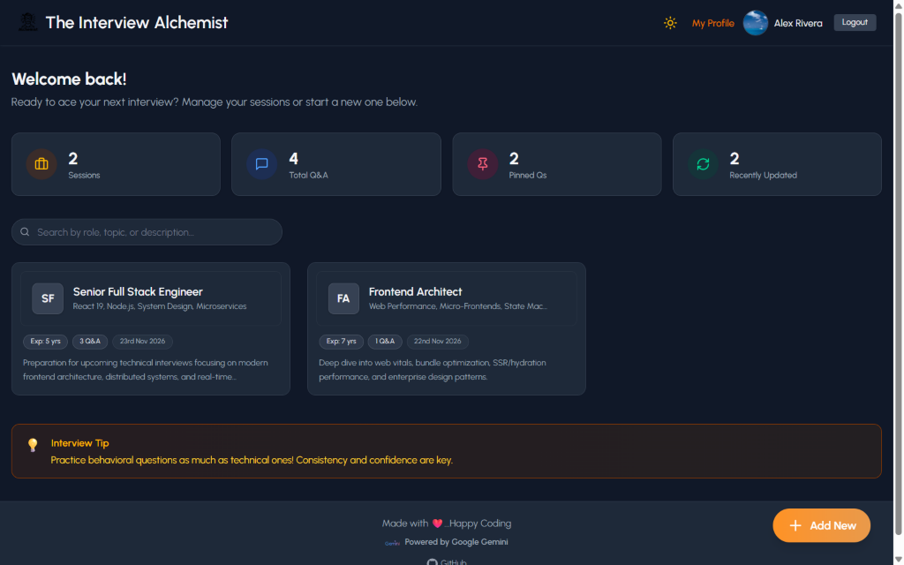
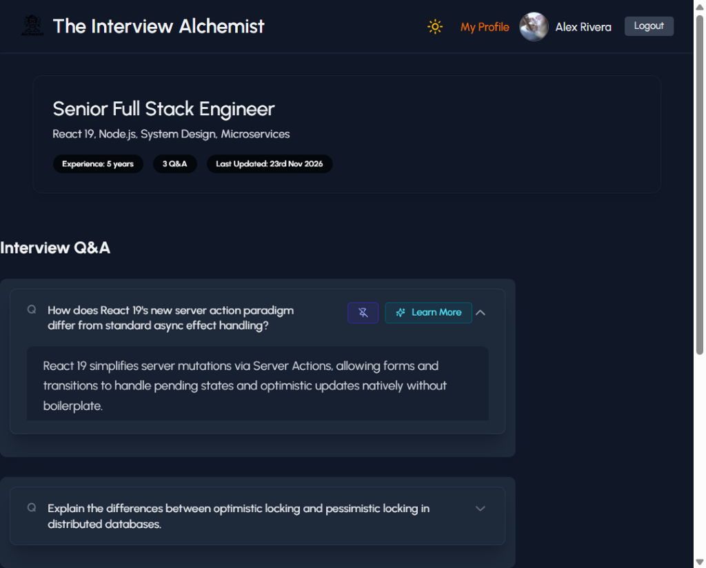
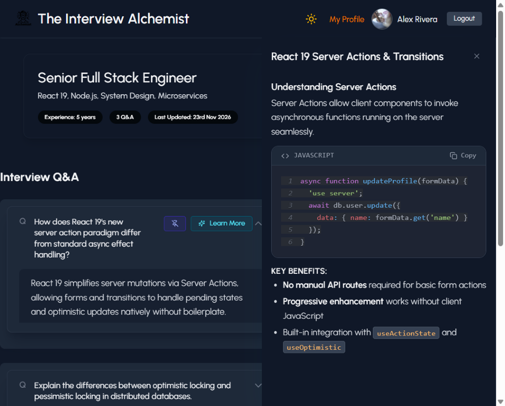
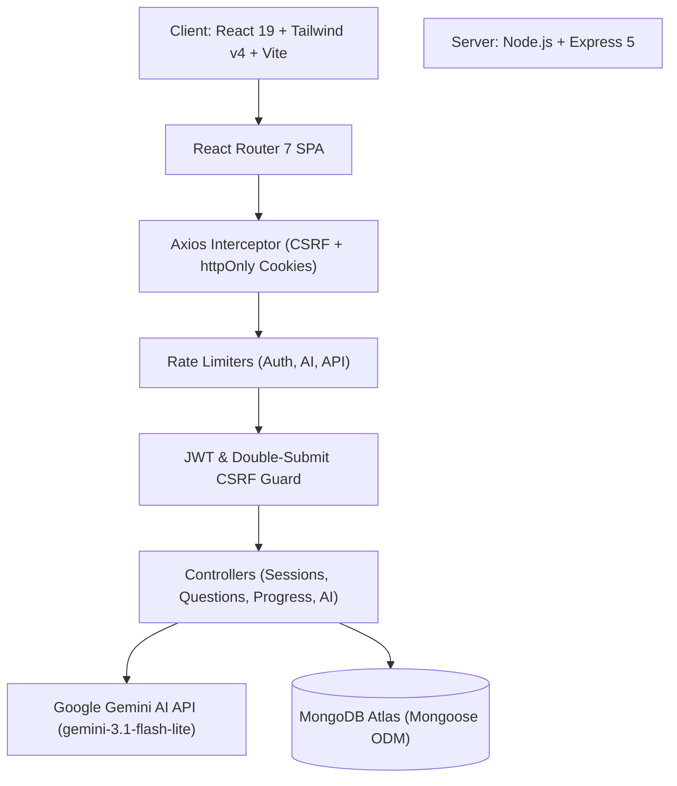

# 🧙‍♂️ The Interview Alchemist

<div align="center">

[](LICENSE)
[](https://nodejs.org/)
[](https://react.dev/)
[](https://tailwindcss.com/)
[](https://www.mongodb.com/atlas)
[](https://ai.google.dev/)

**An intelligent, full-stack interview preparation workspace built with React 19, Express 5, and Google Gemini AI.**  
Transform vague interview preparation into targeted mastery with role-calibrated questions, conceptual deep-dives, code breakdowns, and gamified progress tracking.

[✨ Key Features](#-key-features) • [📸 Visual Tour](#-visual-tour) • [🏗️ Architecture](#️-system-architecture) • [🚀 Quick Start](#-quick-start) • [📡 API Reference](#-api-reference) • [📄 Resume Summary](#-resume--portfolio-summary)

</div>

---

## 🌟 Overview

**The Interview Alchemist** is an AI-native web application designed to eliminate generic interview practice. By integrating Google Gemini's structured output generation (`gemini-3.1-flash-lite-preview`), the platform dynamically crafts role-specific questions tailored to seniority and technical focus areas. Users can bookmark critical concepts, explore instant pedagogical deep dives with interactive code syntax highlighting, track study streaks, and monitor preparation metrics through an intuitive, theme-aware dashboard.

---

## 📸 Visual Tour

<div align="center">

### 🎯 Landing & Exploration

*Modern responsive landing page featuring interview tips rotation, interactive feature highlights, and frictionless authentication.*

---

### 📊 Modern Dashboard (Light & Dark Theme)
| Light Mode | Dark Mode |
|:---:|:---:|
|  |  |

*Full-featured prep dashboard showing active sessions, real-time search filtering, key metrics, and quick session creation.*

---

### 🧠 Interactive Interview Workspace & AI Concept Drawer
| Adaptive Q&A Practice Canvas | Real-Time AI Explanation Drawer |
|:---:|:---:|
|  |  |

*Collapsible question cards with pin/bookmark management and slide-out AI drawers delivering deep conceptual breakdowns with Prism syntax highlighting.*

---

### 📈 Learning Analytics, Goals & Achievements

*Gamified progress tracking with daily/weekly target editors, study streaks, and milestone badges.*

</div>

---

## ✨ Key Features

- **🎯 Role-Calibrated Question Generation:** Dynamically generates structured technical interview questions and sample answers based on exact job title, years of experience, and custom focus topics.
- **🧠 Pedagogical "Learn More" Drawer:** Click any question to open an AI explanation drawer that breaks down underlying concepts with beginner-friendly teaching models and code examples.
- **📌 Question Pinning & Revision Library:** Bookmark high-yield questions for rapid pre-interview revision.
- **💻 Code Syntax Highlighting:** Integrated markdown engine supporting JavaScript, TypeScript, Python, Java, SQL, Bash, and CSS with dual light/dark themes.
- **🏆 Study Streaks & Gamified Achievements:** Tracks daily engagement, consecutive study day streaks, question counts, and unlocks achievement badges.
- **🎯 Dynamic Goal Tracking:** Set and adjust daily session targets and weekly question benchmarks with live progress bars.
- **🌓 Dual-Engine Dark/Light Mode:** Seamless class-based Tailwind CSS v4 theming across all cards, modals, navigation, and code viewers.
- **🛡️ Enterprise Security Model:** JWT tokens in `httpOnly`, `SameSite=Strict` cookies paired with CSRF double-submit token validation and strict rate-limiting.

---

## 🏗️ System Architecture



---

## 🛠️ Tech Stack

| Domain | Technology | Details |
|---|---|---|
| **Frontend** | React 19, Vite 6 | Component-driven SPA with StrictMode |
| **Routing** | React Router 7 | Client-side routing with protected dashboard routes |
| **Styling** | Tailwind CSS 4 | Utility-first styling with `@variant dark` support |
| **Animation & UI** | Framer Motion, Lucide Icons | Fluid layout transitions and SVG iconography |
| **Markdown & Code** | React Markdown, PrismJS, Remark GFM | Multi-language syntax highlighting |
| **Backend** | Node.js (18+), Express 5 | RESTful API architecture |
| **Database** | MongoDB Atlas, Mongoose 8 | Document store with indexing and schema validation |
| **Artificial Intelligence** | Google Gemini API (`@google/generative-ai`) | Structured JSON schema outputs |
| **Authentication** | JWT (`jsonwebtoken`), Bcrypt.js | `httpOnly` secure cookies + double-submit CSRF |
| **Security & Utilities** | Express Rate Limit, Cookie-Parser | DoS protection and brute-force mitigation |

---

## 🚀 Quick Start

### Prerequisites

- **Node.js**: v18.0.0 or higher
- **MongoDB Atlas**: A connection URI (or local MongoDB instance)
- **Google Gemini API Key**: Obtainable from [Google AI Studio](https://aistudio.google.com/app/apikey)

### 1. Clone & Configure

```bash
git clone https://github.com/pratstick/The-Interview-Alchemist.git
cd The-Interview-Alchemist
```

Create a `backend/.env` file:

```env
PORT=8000
ALLOWED_ORIGIN=http://localhost:5173
JWT_SECRET=your_super_secret_jwt_key_here
GOOGLE_API_KEY=your_gemini_api_key_here
MONGO_URI=mongodb+srv://<user>:<password>@<cluster>.mongodb.net/<dbname>?retryWrites=true&w=majority
```

### 2. Install Dependencies

Install both backend and frontend dependencies via the root command:

```bash
npm run install:all
```

*(Or install individually inside `/backend` and `/frontend/the-interview-alchemist` via `npm install`)*

### 3. Run Development Servers

From the repository root:

```bash
# Terminal 1 — Backend API
npm run dev:backend

# Terminal 2 — Frontend Application
npm run dev:frontend
```

Open your browser at **`http://localhost:5173`** (API operates at `http://localhost:8000`).

---

## 📁 Repository Structure

```
The-Interview-Alchemist/
├── backend/
│   ├── config/
│   │   └── db.js                 # MongoDB connection with DNS & error handling
│   ├── controllers/
│   │   ├── aiController.js       # Gemini API client & JSON schema validation
│   │   ├── authController.js     # User registration, login, logout, profile
│   │   ├── progressController.js # Streak calculation, goals, achievements
│   │   ├── questionController.js # Question bookmarking, notes, append
│   │   └── sessionController.js  # CRUD operations for interview sessions
│   ├── middlewares/
│   │   ├── authMiddleware.js     # JWT extraction and validation
│   │   └── uploadMiddleware.js   # Multer file upload handling
│   ├── models/                   # Mongoose schemas (User, Session, Question)
│   ├── routes/                   # Modular Express route declarations
│   ├── utils/
│   │   └── prompts.js            # Gemini prompt engineering templates
│   └── server.js                 # Express server configuration & security setup
│
├── frontend/the-interview-alchemist/
│   ├── public/                   # Static icons & branding assets
│   └── src/
│       ├── assets/               # SVGs, hero illustrations
│       ├── components/           # Reusable UI (Modals, Drawers, Cards, Loaders)
│       ├── context/              # UserContext, ThemeContext
│       ├── pages/
│       │   ├── Auth/             # Login & SignUp modals/pages
│       │   ├── Home/             # Dashboard & CreateSessionForm
│       │   ├── InterviewPrep/    # Question cards, AI response drawer
│       │   ├── Profile/          # Analytics, streaks, achievements, goals
│       │   └── LandingPage.jsx   # Marketing page with dynamic tips
│       └── utils/                # Axios interceptors, API endpoints, helpers
│
└── docs/
    └── screenshots/              # High-resolution application previews
```

---

## 📡 API Reference

All backend API routes are organized under `/api`:

### Authentication & User
| Method | Endpoint | Access | Description |
|---|---|---|---|
| `POST` | `/api/auth/register` | Public | Register new user account |
| `POST` | `/api/auth/login` | Public | Authenticate user, set JWT & CSRF cookies |
| `POST` | `/api/auth/logout` | Private | Clear session & CSRF cookies |
| `GET` | `/api/auth/profile` | Private | Retrieve authenticated user profile |

### Interview Sessions
| Method | Endpoint | Access | Description |
|---|---|---|---|
| `GET` | `/api/sessions/my-sessions` | Private | Fetch all sessions created by logged-in user |
| `POST` | `/api/sessions/create` | Private | Create a new session with initial questions |
| `GET` | `/api/sessions/:id` | Private | Fetch session details and populated questions |
| `DELETE` | `/api/sessions/:id` | Private | Delete a session and associated questions |

### Questions & AI
| Method | Endpoint | Access | Description |
|---|---|---|---|
| `POST` | `/api/questions/add` | Private | Append newly generated questions to a session |
| `POST` | `/api/questions/:id/pin` | Private | Toggle question pin/bookmark status |
| `POST` | `/api/questions/:id/note` | Private | Update personal notes on a question |
| `POST` | `/api/ai/generate-questions` | Private | Generate structured Q&A batch using Gemini |
| `POST` | `/api/ai/generate-explanation`| Private | Generate deep pedagogical explanation with code |

### Progress & Gamification
| Method | Endpoint | Access | Description |
|---|---|---|---|
| `GET` | `/api/progress/stats` | Private | Calculate study streaks, milestones & stats |
| `PUT` | `/api/progress/goals` | Private | Update daily session and weekly question goals |

---

## 📄 Resume / Portfolio Summary

> **Use the section below to copy and paste directly into your resume, portfolio, or LinkedIn profile!**

### 💼 Bullet Points for Software Engineer / Full-Stack Engineer

- **The Interview Alchemist — Full-Stack AI Interview Preparation Platform** *(React 19, Tailwind CSS 4, Node.js, Express, MongoDB, Google Gemini API)*
  - Engineered an end-to-end AI-powered technical interview preparation web platform that generates role- and seniority-calibrated questions with structured JSON output schemas via Google Gemini (`gemini-3.1-flash-lite`).
  - Built an interactive pedagogical study drawer with multi-language code syntax highlighting (PrismJS) and markdown formatting, allowing candidates to deep-dive into complex architectural concepts.
  - Architected a robust security model combining JWTs in `httpOnly`, `SameSite=Strict` cookies, double-submit cookie CSRF defense, and tier-specific rate-limiting for auth, general API, and AI generation endpoints.
  - Implemented an analytics and gamification engine tracking daily study streaks, customizable weekly targets, and milestone badges across persistent MongoDB collections.
  - Designed an accessible, dual-theme UI (Light & Dark mode) adhering to WCAG contrast standards using Tailwind CSS v4, Framer Motion animations, and responsive card layouts.

### 🎤 Interview Elevator Pitch (30 Seconds)

> *"I built **The Interview Alchemist**, a full-stack AI platform designed to make technical interview prep structured and role-specific rather than generic. On the frontend, I used **React 19** and **Tailwind CSS 4** with responsive glassmorphism UI, code syntax highlighting, and an analytics dashboard with study streaks. On the backend, I built an **Express 5** API backed by **MongoDB Atlas** that interfaces with **Google Gemini** using strict JSON response schemas to guarantee valid Q&A formats. I paid strong attention to production security—implementing `httpOnly` JWT sessions with double-submit CSRF tokens and multi-tier rate limiting—as well as comprehensive dark mode accessibility across all components."*

---

## 📄 License

This project is licensed under the [GNU General Public License v3.0](LICENSE).
