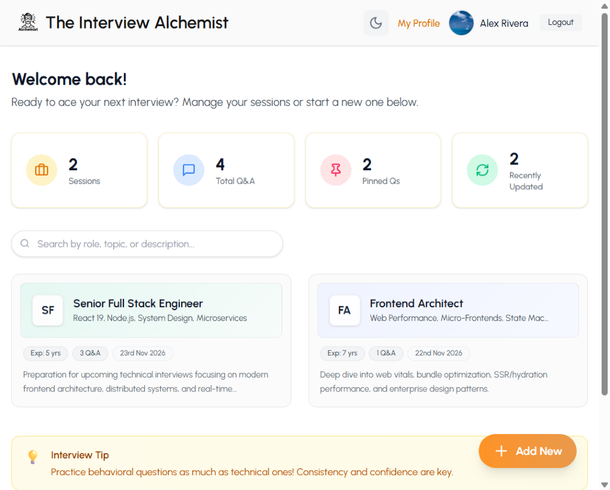
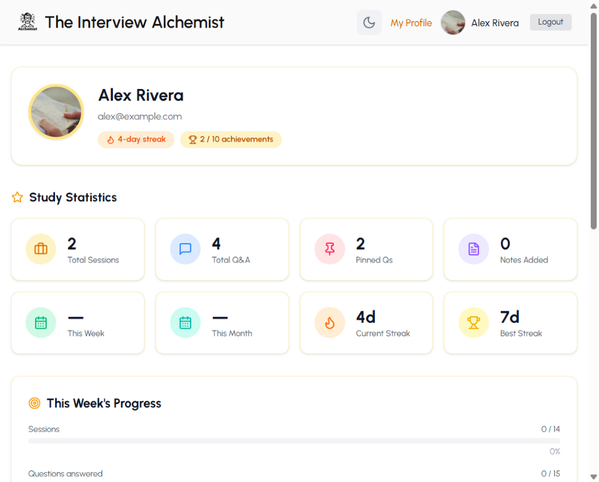
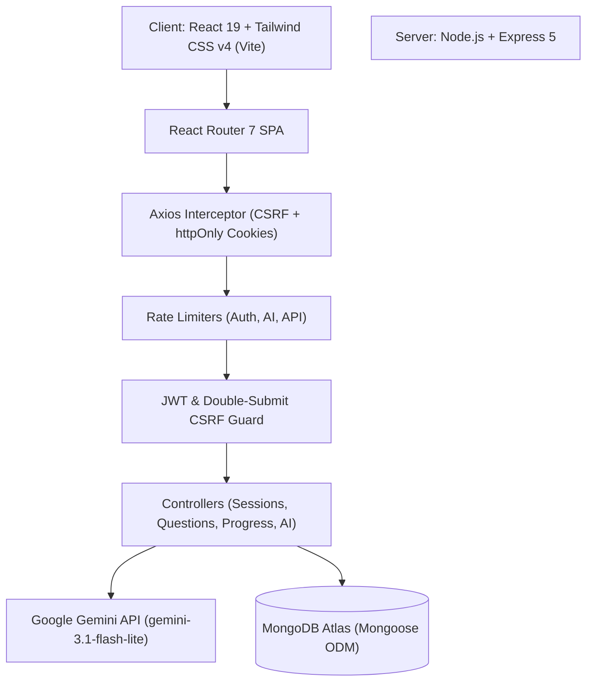

# The Interview Alchemist

<div align="center">

[](LICENSE)
[](https://nodejs.org/)
[](https://react.dev/)
[](https://tailwindcss.com/)
[](https://www.mongodb.com/atlas)
[](https://ai.google.dev/)

An AI-driven technical interview preparation workspace built with React 19, Express 5, and Google Gemini AI.

[Features](#features) • [Screenshots](#screenshots) • [System Architecture](#system-architecture) • [Technology Stack](#technology-stack) • [Getting Started](#getting-started) • [API Reference](#api-reference) • [License](#license)

</div>

---

## Overview

The Interview Alchemist is a full-stack platform engineered to deliver structured, role-specific technical interview preparation. Utilizing Google Gemini with structured JSON output schemas (`gemini-3.1-flash-lite-preview`), the system generates seniority-calibrated question sets and benchmark responses based on user-defined roles and focus topics. Candidates can bookmark key questions, access pedagogical concept explanations with syntax-highlighted code blocks, manage study targets, and analyze progress across dark and light environments.

---

## Screenshots

<div align="center">

### Application Landing


---

### Dashboard (Light and Dark Themes)
| Light Mode | Dark Mode |
|:---:|:---:|
|  |  |

---

### Interview Workspace & Conceptual Deep-Dive Drawer
| Question Accordion Canvas | AI Explanation Drawer with Syntax Highlighting |
|:---:|:---:|
|  |  |

---

### Learning Analytics, Goals & Achievements


</div>

---

## Features

- **Role-Calibrated Question Generation:** Generates structured technical interview question batches tailored to target job titles, experience level, and specific technical competencies.
- **Pedagogical Explanation Drawer:** Slide-out drawer delivering conceptual breakdowns of interview problems with code illustrations and beginner-friendly teaching models.
- **Question Bookmarking:** Bookmark and organize critical questions into a personal revision library.
- **Multi-Language Syntax Highlighting:** Integrated Markdown preview with PrismJS highlighting for JavaScript, TypeScript, Python, Java, SQL, Bash, and CSS.
- **Study Analytics and Streaks:** Tracks session volume, cumulative question count, consecutive daily study streaks, and milestone achievements.
- **Adaptive Goal Management:** Configurable daily session goals and weekly question targets with interactive progress visualization.
- **Dual Theme Support:** Comprehensive class-based Tailwind CSS v4 light and dark themes across all pages and components.
- **Authentication and Defense in Depth:** Session management via JWT in `httpOnly`, `SameSite=Strict` cookies paired with double-submit CSRF cookie validation and multi-tier rate limiting.

---

## System Architecture



---

## Technology Stack

| Layer | Technology | Purpose |
|---|---|---|
| **Frontend Framework** | React 19, Vite 6 | Component-based single page application |
| **Routing** | React Router 7 | Client-side routing and protected view boundaries |
| **Styling** | Tailwind CSS 4 | Utility-first styling with native class-based dark mode |
| **Transitions & UI** | Framer Motion, Lucide Icons | Interface animations and vector iconography |
| **Markdown & Code** | React Markdown, PrismJS, Remark GFM | Code formatting and multi-language syntax highlighting |
| **Backend Runtime** | Node.js (18+), Express 5 | RESTful API server and middleware pipeline |
| **Database** | MongoDB Atlas, Mongoose 8 | Document persistence, schema validation, and indexing |
| **AI Integration** | Google Gemini API (`@google/generative-ai`) | Structured JSON question generation and conceptual breakdown |
| **Authentication** | JWT (`jsonwebtoken`), Bcrypt.js | Cryptographic hashing and token-based session handling |
| **Security** | Express Rate Limit, Cookie-Parser | Rate-limiting, brute-force mitigation, and CSRF protection |

---

## Getting Started

### Prerequisites

- Node.js 18.0.0 or higher
- MongoDB Atlas cluster connection URI
- Google Gemini API key from [Google AI Studio](https://aistudio.google.com/app/apikey)

### 1. Clone the Repository

```bash
git clone https://github.com/pratstick/The-Interview-Alchemist.git
cd The-Interview-Alchemist
```

### 2. Configure Environment Variables

Create a `backend/.env` file with the following variables:

```env
PORT=8000
ALLOWED_ORIGIN=http://localhost:5173
JWT_SECRET=your_jwt_secret_here
GOOGLE_API_KEY=your_google_gemini_api_key
MONGO_URI=mongodb+srv://<user>:<password>@<cluster>.mongodb.net/<dbname>?retryWrites=true&w=majority
```

### 3. Install Dependencies

Install all dependencies across backend and frontend:

```bash
npm run install:all
```

### 4. Run Development Servers

From the root directory:

```bash
# Terminal 1: Backend API
npm run dev:backend

# Terminal 2: Frontend Application
npm run dev:frontend
```

The frontend client will be available at `http://localhost:5173` and the backend service at `http://localhost:8000`.

---

## Repository Structure

```
The-Interview-Alchemist/
├── backend/
│   ├── config/
│   │   └── db.js                 # Database connection and network diagnostics
│   ├── controllers/
│   │   ├── aiController.js       # Gemini API client and schema enforcement
│   │   ├── authController.js     # User registration, login, logout, profile
│   │   ├── progressController.js # Streak calculation, goals, achievements
│   │   ├── questionController.js # Question bookmarking, notes, append operations
│   │   └── sessionController.js  # CRUD operations for interview sessions
│   ├── middlewares/
│   │   ├── authMiddleware.js     # JWT extraction and validation
│   │   └── uploadMiddleware.js   # Multer storage configuration
│   ├── models/                   # Mongoose schemas (User, Session, Question)
│   ├── routes/                   # Express route definitions
│   ├── utils/
│   │   └── prompts.js            # Prompt templates for Gemini models
│   └── server.js                 # Server entry point and middleware pipeline
│
├── frontend/the-interview-alchemist/
│   ├── public/                   # Static branding assets
│   └── src/
│       ├── assets/               # SVGs and UI illustrations
│       ├── components/           # Reusable UI components (Modals, Drawers, Cards)
│       ├── context/              # Context providers (ThemeContext, UserContext)
│       ├── pages/
│       │   ├── Auth/             # Login and registration views
│       │   ├── Home/             # Dashboard and session creation
│       │   ├── InterviewPrep/    # Question cards, accordion, AI drawer
│       │   ├── Profile/          # Analytics, streaks, goals, achievements
│       │   └── LandingPage.jsx   # Marketing and landing interface
│       └── utils/                # Axios configuration, API paths, utilities
│
└── docs/
    └── screenshots/              # Application preview screenshots
```

---

## API Reference

All endpoints are mounted under `/api`.

### Authentication
| Method | Endpoint | Access | Description |
|---|---|---|---|
| `POST` | `/api/auth/register` | Public | Register a new user account |
| `POST` | `/api/auth/login` | Public | Authenticate user and issue JWT and CSRF cookies |
| `POST` | `/api/auth/logout` | Private | Clear authentication and CSRF cookies |
| `GET` | `/api/auth/profile` | Private | Retrieve authenticated user profile |

### Sessions
| Method | Endpoint | Access | Description |
|---|---|---|---|
| `GET` | `/api/sessions/my-sessions` | Private | Fetch all sessions belonging to the user |
| `POST` | `/api/sessions/create` | Private | Create a new session with initial questions |
| `GET` | `/api/sessions/:id` | Private | Retrieve session details with populated questions |
| `DELETE` | `/api/sessions/:id` | Private | Delete a session and its associated questions |

### Questions and AI
| Method | Endpoint | Access | Description |
|---|---|---|---|
| `POST` | `/api/questions/add` | Private | Append additional questions to an existing session |
| `POST` | `/api/questions/:id/pin` | Private | Toggle pin status on a question |
| `POST` | `/api/questions/:id/note` | Private | Update personal notes on a question |
| `POST` | `/api/ai/generate-questions` | Private | Generate structured question batch via Gemini |
| `POST` | `/api/ai/generate-explanation` | Private | Generate conceptual explanation with code examples |

### Progress and Analytics
| Method | Endpoint | Access | Description |
|---|---|---|---|
| `GET` | `/api/progress/stats` | Private | Calculate study streaks, milestones, and statistics |
| `PUT` | `/api/progress/goals` | Private | Update daily session and weekly question goals |

---

## License

This project is licensed under the [GNU General Public License v3.0](LICENSE).
